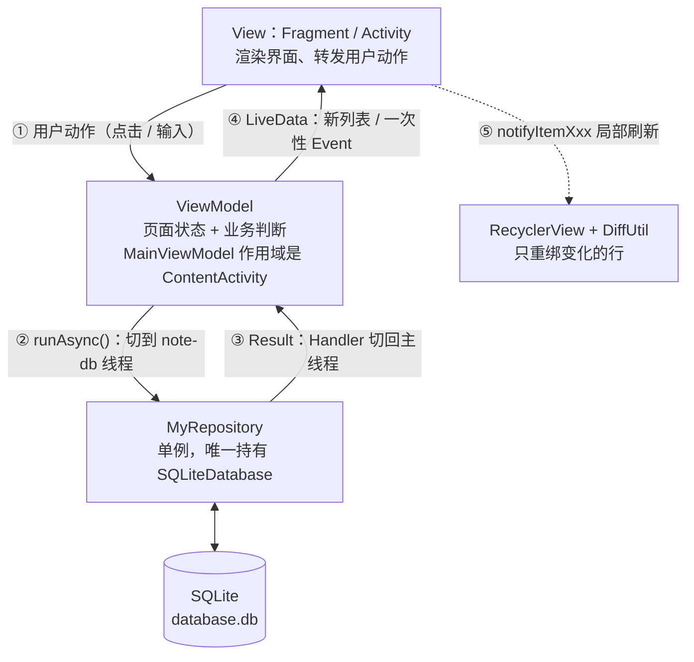
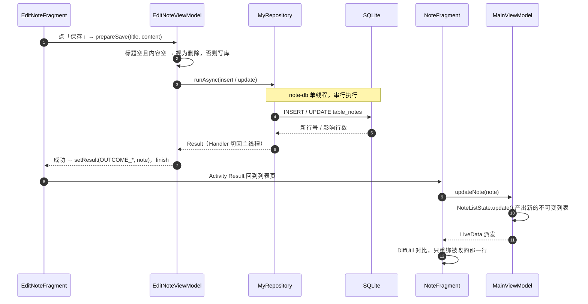

# Note.app — 简易记事本

一个 Android 本地记事本 App：账号登录/注册、笔记增删改查、分组管理、按编辑时间排序、标题搜索，全部数据存在本机 SQLite 中，不联网。

## 功能

- 注册 / 登录 / 修改密码 / 切换账号 / 注销账号
- 笔记：新建、编辑、删除、保存时记录编辑时间
- 分组：新建、重命名、删除（删除分组会连带删除组内笔记）；「全部笔记」是内置的 `groupId = 0` 聚合视图
- 笔记可归入某个分组，同时保留在「全部笔记」中
- 按编辑时间升序 / 降序排序
- 按标题模糊搜索

## 技术栈

| 项 | 版本 / 说明 |
| --- | --- |
| 语言 | Java 11 |
| 构建 | Gradle 8.11.1 + AGP 8.9.1 |
| compileSdk / targetSdk / minSdk | 35 / 35 / 21 |
| UI | View + Fragment + ViewBinding，Material Components，单 Activity + 底部导航 |
| 状态 | MVVM：页面级 ViewModel（Java + LiveData，单向数据流） |
| 分包 | 按功能分包（`feature/*`）+ `data` / `domain` / `core`，层由类名后缀体现 |
| 存储 | SQLite（`SQLiteOpenHelper`，库名 `database.db`，连接由 `MyRepository` 单例统一持有） |

## 目录结构

```
app/src/main/java/com/iteam/examproject/
├── data/                 数据层：只有这里知道「数据存在哪、长什么样」
│   ├── MyRepository      全部 SQL + 线程调度（runAsync）
│   ├── MyDatabaseHelper  建表 / 索引 / 版本迁移
│   ├── PasswordUtil      口令摘要（定义口令在库里怎么存）
│   └── model/            User、NoteGroup、Notes（纯数据类，可跨页传输）
├── domain/               业务与状态逻辑：纯 Java，不依赖 Android，可直接跑 JVM 单测
│   ├── NoteListState     列表 + 排序的不可变状态机
│   └── NoteListOps       列表的排序 / 插入 / 替换 / 删除
├── core/                 跨功能通用件：没有业务语义，换个项目也能用
│   ├── Event             一次性事件包装
│   ├── ToastUtil         复用同一个 Toast 实例，避免连续操作排队
│   ├── RvDecorationUtil  RecyclerView 间距装饰
│   └── DensityUtil       dp / px 换算
└── feature/              按功能分包：一个功能的 View + ViewModel + Adapter 聚在一起
    ├── auth/             登录 / 注册 / 切换账号（Activity、Fragment、AuthViewModel）
    ├── main/             ContentActivity + MainViewModel（会话、当前分组、列表、排序）
    ├── notes/            笔记列表页 NoteFragment + NoteAdapter + 三个对话框适配器
    ├── editor/           笔记编辑页（EditNoteActivity、EditNoteFragment、EditNoteViewModel）
    ├── group/            分组管理页（GroupFragment、GroupManagementAdapter、GroupManageViewModel）
    └── mine/             「我的」页
```

### 分包原则

- **按功能分，不按层分。** 类名后缀已经说明了它在哪一层（`XxxFragment` / `XxxViewModel` / `XxxAdapter` / `MyRepository`），
  包再按层切一次，等于把一个功能的代码摊到 `ui/fragment`、`viewmodel`、`adapter` 三个目录里：
  改「笔记列表」要在三处来回跳，而 `adapter/` 下的五个适配器光看目录分不出哪个属于哪个页面。
- **数据层独占一层。** `data` 是「数据在哪」的唯一答案：SQL、建表、连接、线程调度都在这里，别的包不出现 `SQLiteDatabase` / `Cursor`。
- **纯逻辑单独成层。** `domain` 里是不依赖 Android 的类，能在 JVM 上直接跑单测——它是整个项目唯一能被廉价测试覆盖的部分，
  所以测试包和它一一对应（`app/src/test/.../domain`）。
- **`core` 只放通用件。** 判断标准：删掉它，哪个功能会坏？如果一个都答不上来，它就属于 `core`，而不是某个 feature。
- **依赖方向单向。** `feature` → `domain` / `core` / `data`；`domain` 与 `data` 只依赖 `data.model`；`core` 不依赖项目内其他包。
  跨层访问只有一条许可路径：**ViewModel 调 `MyRepository`**，界面层（Fragment / Activity / Adapter）不 import 数据层。

## 数据库表

| 表 | 字段 |
| --- | --- |
| `table_users` | userId(PK)、account、password |
| `table_groups` | userId、groupId(PK)、groupName |
| `table_notes` | userId、groupId、notesId、title、content、editedTime |

`table_notes` 里同一条笔记在不同分组下会有多行记录，它们共享同一个 `notesId`。

## 运行

1. 需要 JDK 17（AGP 8.9 要求）与 Android SDK 35。
2. 在项目根目录创建 `local.properties`，写入 `sdk.dir=<你的 SDK 路径>`。
3. 执行 `./gradlew assembleDebug`，或直接用 Android Studio 打开运行。

> release 构建依赖本地的 `keystore.properties`（已被 `.gitignore` 排除）；文件不存在时 `assembleRelease` 产出未签名包，不影响他人克隆构建。

单元测试（纯 JVM，不需要模拟器）：`./gradlew testDebugUnitTest`，覆盖 `domain/NoteListOps` 与 `domain/NoteListState` 的排序与增删改行为。
`domain` 之外的层没有单元测试（依赖 Android 框架），靠真机回归。

## 发布正式版

正式包必须继续用**同一把密钥**签名，否则已经装了旧版的用户无法覆盖升级（签名不一致会安装失败，只能卸载重装、本地数据全丢）。

| 项 | 值 |
| --- | --- |
| 当前版本 | `v1.0.0` · versionCode `2` · versionName `1.0.0` |
| 历史版本 | `v1.0.0-apha` · versionCode `1` · versionName `1.0` |
| 签名密钥 | `as_key.jks`，别名 `hwt_as_key`（PKCS12，RSA 2048） |
| 证书 SHA-256 | `31:1F:CB:2A:8B:13:FF:59:6A:14:E3:B8:BF:BB:27:14:53:37:87:7C:76:57:2E:1C:4F:83:85:F4:C4:B6:E5:C5` |
| 证书有效期 | 2025-10-18 ~ 2050-10-12 |

- 密钥和口令都不进仓库：`.gitignore` 已排除 `*.jks` / `*.keystore` / `keystore.properties`。
- 签名已接入构建流程：`app/build.gradle.kts` 的 `signingConfigs` 从根目录 `keystore.properties` 读取，本地建好该文件后 `./gradlew assembleRelease` 直接产出已签名包。
- 每次发版 `versionCode` 必须严格大于已发布的值（当前 `2`），`versionName` 同步改。
- 校验手上的包是不是同一把钥匙签的：

```bash
apksigner verify --print-certs app-release.apk
```

输出里的 `certificate SHA-256 digest` 应等于上表那串（小写、去掉冒号）。

## 密码存储

`table_users.password` 存的是加盐摘要，格式 `sha256$迭代次数$盐(Base64)$摘要(Base64)`，每个密码单独随机盐、10000 次 SHA-256 迭代，实现见 `data/PasswordUtil`。
早期版本写入的明文密码仍可登录，登录成功时自动升级为摘要；`SharedPreferences` 中不再保存密码。

## 架构与数据流

View 只表达「用户做了什么」，ViewModel 决定「该做什么」，Repository 只管「怎么读写」。
数据始终沿一个方向流动，回流的只有**结果**：



界面层不出现 `MyRepository.getInstance()`：数据访问、线程调度、业务判断都在 ViewModel 里。

### 保存一篇笔记时发生了什么



关键点：**写库成功后没有再把整张表查回来**。写操作本来就知道自己动了哪一条（新建有行号，编辑和删除有 `notesId`），
所以「刷新界面」= 在内存列表上改这一条 + 重排，省掉一次全表 `SELECT` 和逐行构造对象。

### 读取路径

| 场景 | 走哪条路 |
| --- | --- |
| 登录成功、切换分组 | `MyRepository.getNotesList()` 整表查一次（换了一整份数据） |
| 新建 / 编辑 / 删除笔记 | 内存增量更新，不查库（认不出被改的那一条时兜底重查一次） |
| 排序 | 内存重排，不查库 |
| 搜索 | `MyRepository.searchNotes()`，结果只进对话框，不动主列表 |
| 分组增删改 | `MyRepository` 查询后派发 `LiveData<List<NoteGroup>>` |

### 线程与状态约定

- `MyRepository` 是单例，全进程只有一条 SQLite 连接，生命周期跟随进程，业务代码不需要开关连接。
- 所有数据库操作都在一条名为 `note-db` 的后台线程上**串行**执行：界面层用 `runAsync(work, callback)` 提交，
  结果经主线程 Handler 回调。串行既保证「先写后读」的顺序，也天然避免并发写。
- 界面层不要直接调用 `MyRepository` 上的同步方法，那会在调用线程上当场执行 SQL。
- `runAsync` 的回调收到的是 `Result<T>`：`isSuccess()` 区分「执行失败」与「业务上没有结果」。
  - 登录密码错误属于后者：`isSuccess() == true`，`getData() == null`；
  - SQL 抛异常属于前者：`isSuccess() == false`，界面统一提示「操作失败，请重试」。
  - 无返回值的写操作用三参数版本 `runAsync(work, onSuccess, onError)`。
- **状态归属**：`MainViewModel` 作用域是 ContentActivity（`ViewModelProvider(requireActivity())`），
  持有当前用户、当前分组、笔记列表和排序方式，列表页与分组页共享同一份，退出登录随页面销毁；
  `EditNoteViewModel` / `AuthViewModel` / `GroupManageViewModel` 各自管自己页面的状态。
- **跨页传参**：编辑页要编辑哪篇笔记由 Intent 传入（`Notes` 实现了 `Serializable`），
  保存/删除结果通过 Activity Result 回传列表页，取代原来「先写单例再 startActivity」的时序约定。
- **切换账号**：从「我的」正常 `startActivity` 叠一层登录页，不清任务栈、也不 `finish()` 内容界面——
  手势返回 / 返回箭头就是「反悔」，回到「我的」，登录态全程没被动过（切换模式只关掉自动登录，不写 SP）；
  按 Home、手势回桌面也算放弃切换：`LoginAndRegisterActivity.onUserLeaveHint()` 会把自己关掉，
  避免任务栈里留着一个已经离开过的切换页（用 `onUserLeaveHint` 而非 `onStop`，旋转屏幕和灭屏不受影响）；
  登录成功后用 `FLAG_ACTIVITY_CLEAR_TOP` 重建内容界面，避免旧账号的实例还压在栈里。
  只有「注销 / 退出登录」才用 `CLEAR_TASK`，因为那时已经没有可返回的会话了。
- **一次性事件**（Toast、跳登录页）用 `core/Event` 包装，观察者取过一次就不再重放，旋转屏幕不会重复弹。
- **提示统一走 `core/ToastUtil`**：内部复用同一个 Toast 实例，新提示会顶掉正在显示的那条，
  不会因为连续操作排成一串；界面层不直接调 `Toast.makeText`（一次调用就是一条会排队的提示）。
- 笔记列表走**增量更新**：写库成功后不再把整张表查回来，而是按 `notesId` 在内存列表上插入 / 替换 / 删除这一条，
  状态机在 `domain/NoteListState`（纯 Java，可单元测试），底层操作在 `domain/NoteListOps`。
  只有「登录」和「切换分组」这种换了一整份数据的场景才调 `MyRepository.getNotesList` 重新查库；
  若列表里认不出被改的那一条（早期数据 `notesId` 为 0 且标题、时间都变了），会退回一次整表重查兜底。
- 列表顺序只有一个来源：`NoteListState.sortWay`（默认按编辑时间倒序）。整份替换时的排序、写操作后的插入位置、
  用户点「排序」都按它算，排序本身也在内存里完成，不再查库；代价是排序方式一旦选了就一直沿用，切换分组后也不重置。

## 已知问题

- 分组与笔记的多行冗余存储（同一篇笔记在「全部笔记」与分组里各一行）靠 `notesId` 约定同步，
  改动任一处都要记得两边一起改（`updateNotes` 已按 `notesId` 一次改所有分组，`deleteNotes` 视 `groupId` 决定删一行还是全部）

## License

[MIT](LICENSE) © 2026 tide-0x

可以自由使用、修改、分发（含商业用途），保留版权与许可声明即可。
